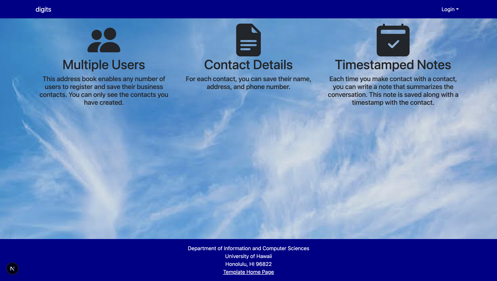

# Digits

Digits is a web app for adding, viewing, and editing contacts and keeping notes about them.

## Installation

1. Clone this repository and open the `digits` folder in VS Code.
2. Install the project dependencies:

   ```bash
   npm install
   ```

3. Start PostgreSQL and create the `digits` database:

   ```bash
   createdb digits
   ```

4. If you do not already have an `.env` file, copy `sample.env`:

   ```bash
   cp sample.env .env
   ```

   Set `DATABASE_URL` in `.env` to use your local PostgreSQL credentials and the `digits` database. Keep `.env` out of Git.

5. Apply the migrations, generate the Prisma Client, and load the sample data:

   ```bash
   npx prisma migrate dev
   npx prisma generate
   npx prisma db seed
   ```

6. Start the application:

   ```bash
   npm run dev
   ```

7. Open [http://localhost:3000](http://localhost:3000) in your browser.

## Application Walkthrough

### Landing Page

The landing page introduces Digits. Select **Sign In** to access the contact manager.

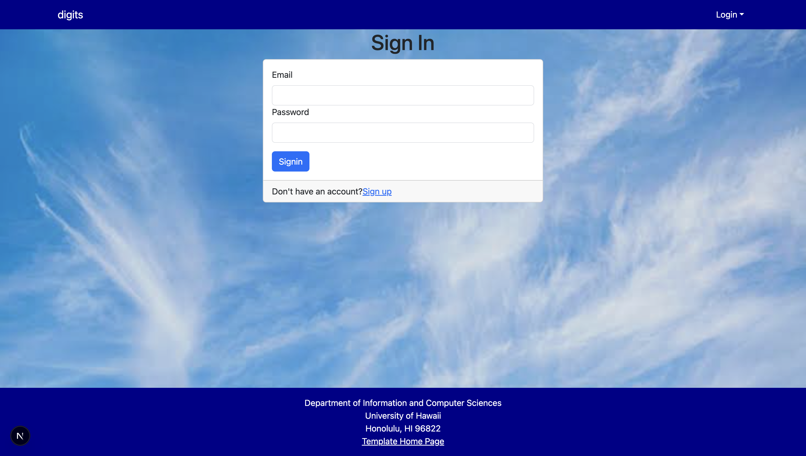

### Sign In

After seeding your local database, sign in as `john@foo.com`. If you kept the default demo password, use `changeme`. This is what the Landing page will look like after login.

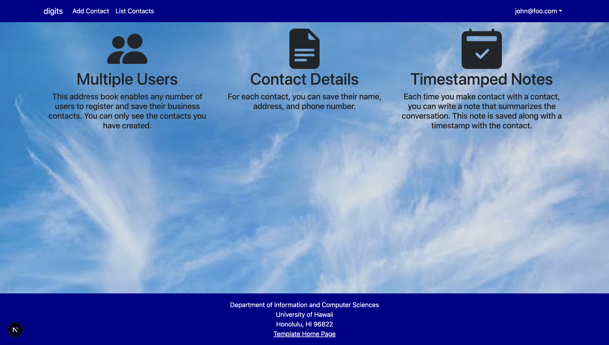

### Add Contact

Select **Add Contact** and enter the contact’s first name, last name, address, image URL, and description. Submit the form to save the contact.

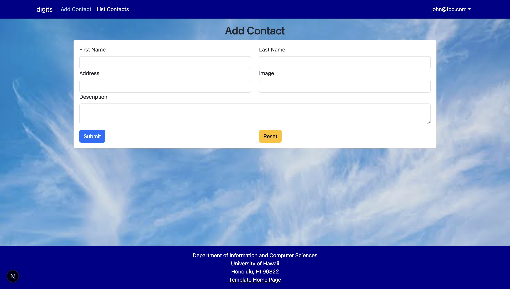

### List Contacts

Select **List Contacts** to see the contacts associated with your account. Each contact card shows the contact’s name, photo, address, and description.

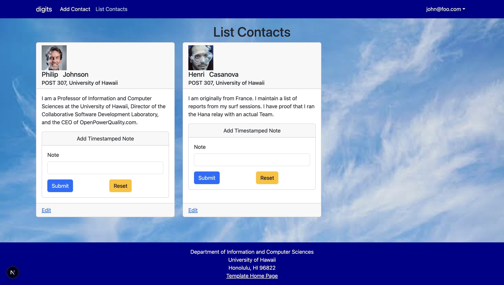

### Edit Contact

Select **Edit** on a contact card to update its information. Save your changes and return to **List Contacts** to see the updated card.

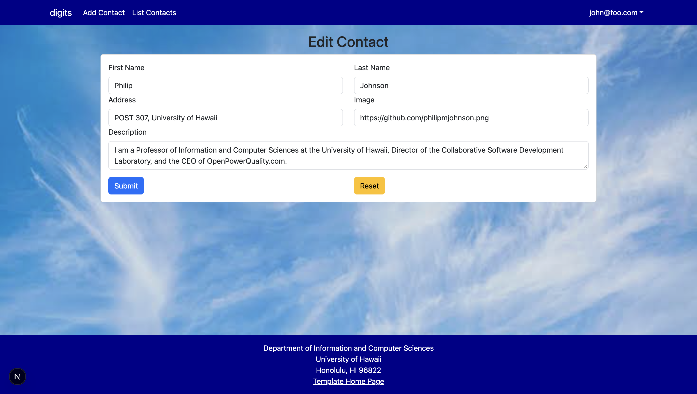

### Add Contact Notes

Open **List Contacts** and find the contact you want to write a note about. Enter your note in the form on the contact’s card and submit it. The saved note appears on that same card.

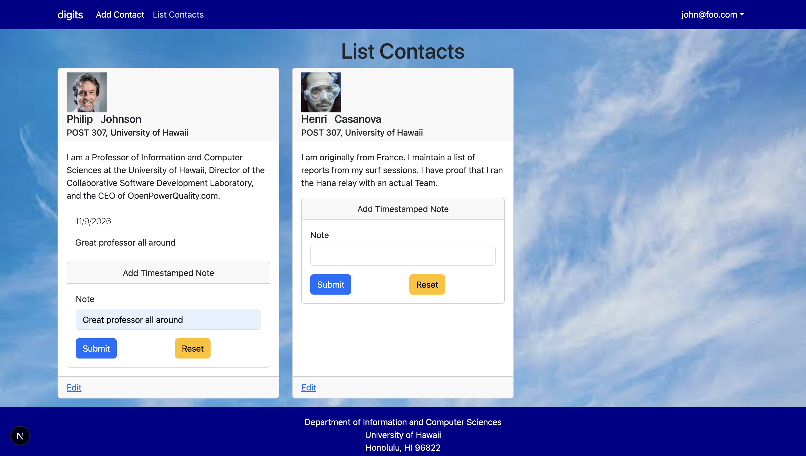

### Admin Sign In

After seeding your local database, you can also sign in as the admin with `admin@foo.com`. If you kept the default demo password, use `changeme`. This is what the Landing page will look like after login.

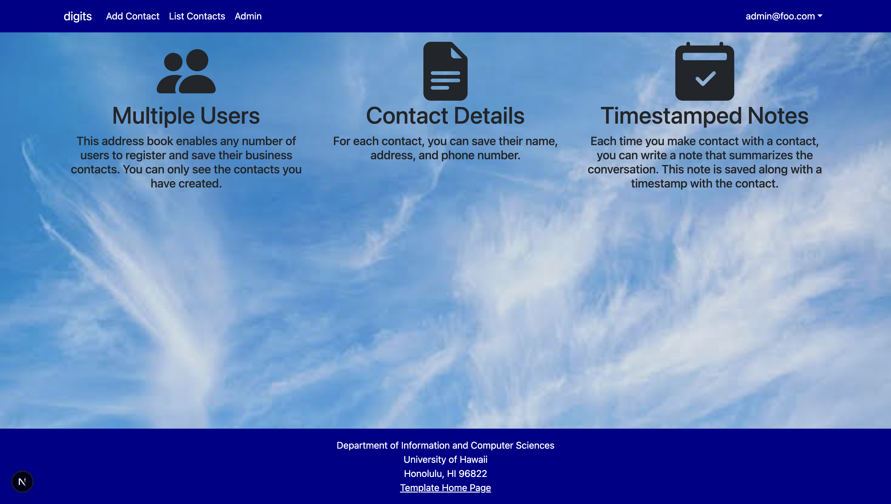

### List Contacts Admin

In the Admin tab it will list all the contacts from `admin@foo.com` and `john@foo.com`. This makes it so the admin can see all the contacts that were added.

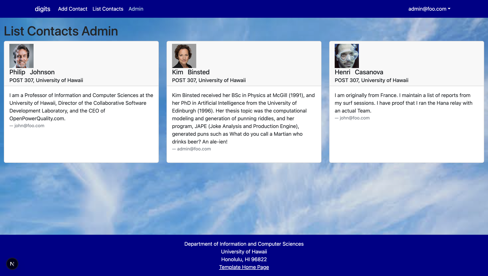

### Change Password Page

If you need the change the password in the top right corner of the page click your user name for the drop down box then click on the Change Password promt.

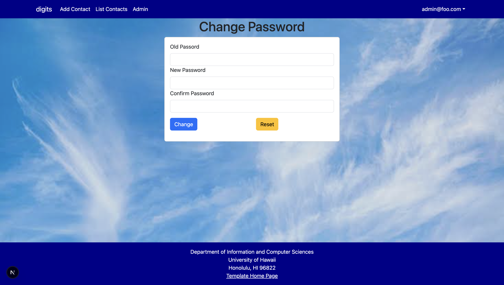

### Sign Out Page

You can also signout on the same dropdown that you used to sign in as well

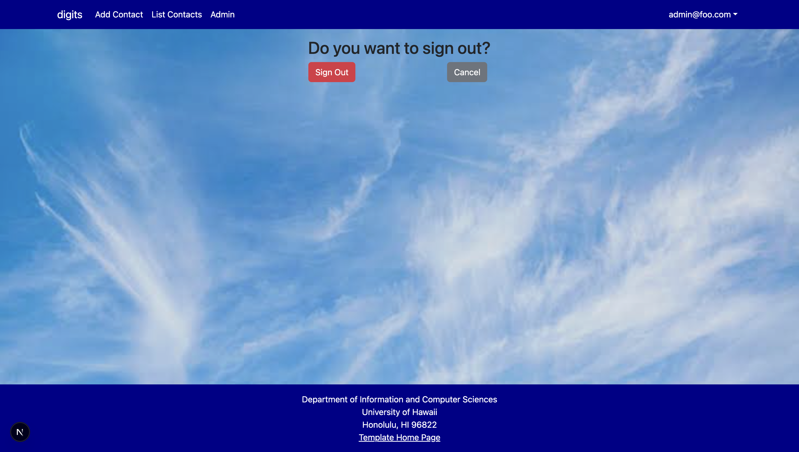

### Sign Up Page

You can also register for an account in the sign up page that you can find right under the sign up tab in the top right corner.

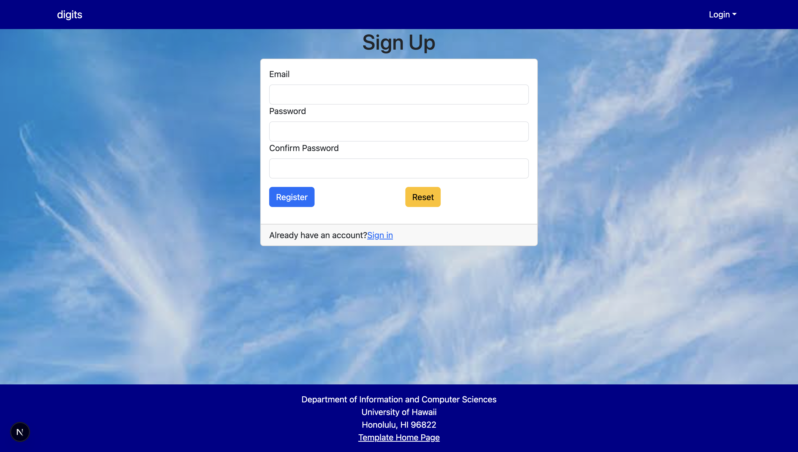